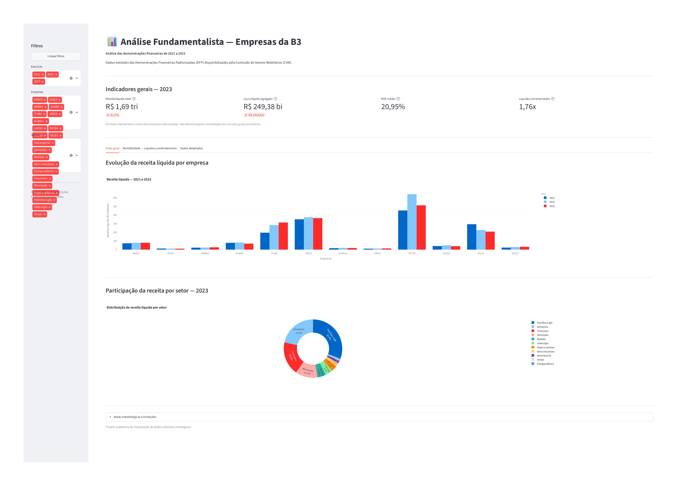
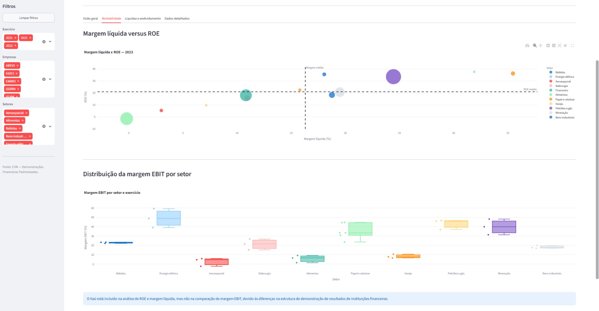
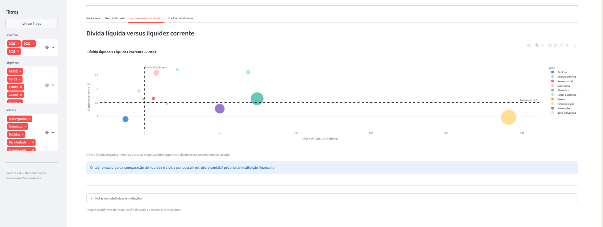
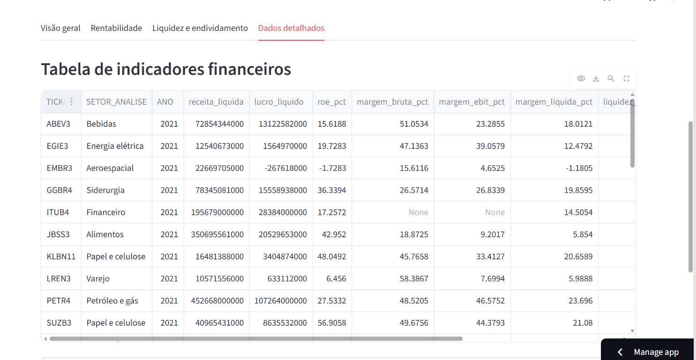
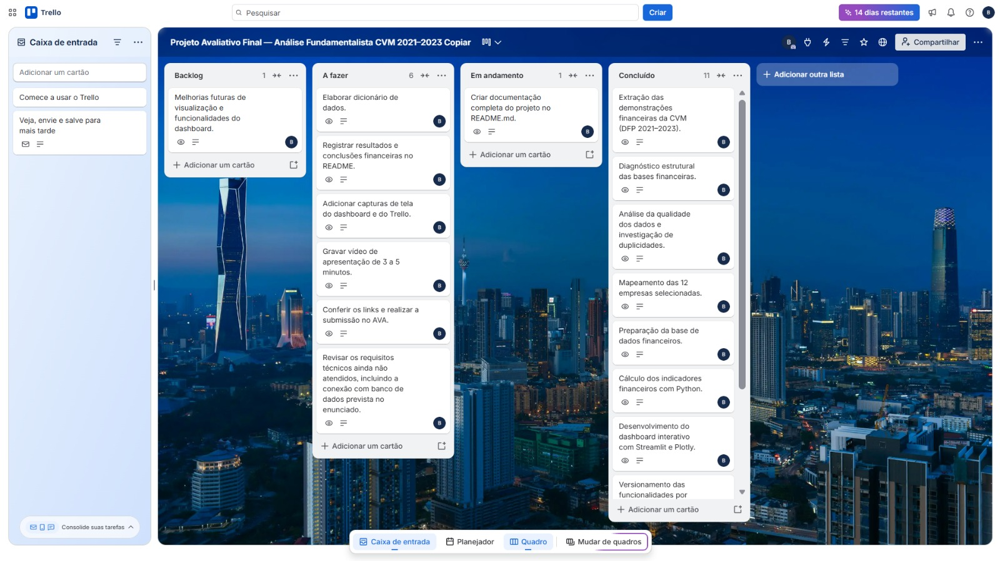

# Análise Fundamentalista — Empresas da B3 (CVM/DFP 2021–2023)

## 1. Resumo executivo

Projeto acadêmico de análise econômico-financeira de 12 companhias abertas brasileiras, com dados das Demonstrações Financeiras Padronizadas (DFP) disponibilizadas pela Comissão de Valores Mobiliários (CVM), referentes aos exercícios de 2021, 2022 e 2023.

O trabalho contempla extração, diagnóstico e preparação dos dados, cálculo de indicadores com Python e apresentação em dashboard interativo desenvolvido com Streamlit e Plotly. Trata-se de uma análise exploratória e acadêmica, não de recomendação de investimento.

## 2. Contexto de negócio e perguntas orientadoras

A análise das demonstrações financeiras permite observar a evolução dos resultados, da rentabilidade, da liquidez e do endividamento das empresas. O projeto busca responder às seguintes perguntas:

1. Quais empresas e setores apresentaram maior crescimento de Receita Líquida entre 2021 e 2023? Quais tiveram contração?
2. Qual companhia apresentou maior ROE e como a Margem Líquida evoluiu ao longo dos exercícios?
3. Como a estrutura de custos se relaciona com a Margem EBIT e como os resultados variam entre setores?
4. Quais empresas apresentaram Liquidez Corrente inferior a 1,5x e como se comportou sua Dívida Líquida?
5. Como se distribuiu a Receita Líquida entre os setores no exercício mais recente (2023)?

## 3. Fonte de dados e período

- **Fonte oficial:** [Portal de Dados Abertos da CVM — Demonstrações Financeiras Padronizadas (DFP)](https://dados.cvm.gov.br/dados/CIA_ABERTA/DOC/DFP/DADOS/).
- **Período:** exercícios anuais de 2021, 2022 e 2023.
- **Demonstrações utilizadas:** DRE consolidada, Balanço Patrimonial Ativo (BPA) consolidado e Balanço Patrimonial Passivo (BPP) consolidado.
- **Contas principais:** Receita Líquida (3.01), Lucro Bruto (3.03), EBIT/resultado antes do resultado financeiro e dos tributos (3.05), Lucro Líquido (3.11; com tratamento específico para ITUB4), Ativo Circulante, Passivo Circulante, Patrimônio Líquido e contas de dívida e caixa utilizadas no cálculo da Dívida Líquida.

Os dados são públicos e disponibilizados pela CVM. Este repositório não atribui licença própria aos arquivos originais; consulte as condições de uso indicadas no portal oficial antes de reutilizar ou redistribuir os dados.

### Empresas selecionadas

| Ticker | Empresa | Setor utilizado na análise |
|---|---|---|
| ABEV3 | Ambev | Bebidas |
| EGIE3 | Engie Brasil | Energia elétrica |
| EMBR3 | Embraer | Aeroespacial |
| GGBR4 | Gerdau | Siderurgia |
| ITUB4 | Itaú Unibanco | Financeiro |
| JBSS3 | JBS | Alimentos |
| KLBN11 | Klabin | Papel e celulose |
| LREN3 | Lojas Renner | Varejo |
| PETR4 | Petrobras | Petróleo e gás |
| SUZB3 | Suzano | Papel e celulose |
| VALE3 | Vale | Mineração |
| WEG3 | WEG | Bens industriais |

A classificação setorial foi definida para fins de agrupamento e comparação no dashboard. Ela não substitui uma classificação setorial oficial da bolsa ou de outra entidade.

## 4. Pipeline de engenharia de dados (ETL)

Os scripts estão organizados na pasta `src/` e devem ser executados na seguinte ordem:

1. `01_extrair_cvm.py`: extrai BPA, BPP e DRE consolidados dos ZIPs DFP anuais. Os ZIPs originais devem estar em `data/raw/`.
2. `02_diagnostico_bases.py`: realiza o diagnóstico estrutural das bases extraídas.
3. `03_qualidade_dados.py`: verifica valores ausentes, duplicidades, formatos, datas e outras condições de qualidade.
4. `04_investigar_duplicidades.py`: investiga registros repetidos e possíveis divergências.
5. `05_detalhar_divergencias.py`: detalha os grupos de registros com valores divergentes.
6. `06_mapear_empresas_selecionadas.py`: mapeia as 12 empresas por código CVM.
7. `07_preparar_base_selecionada.py`: filtra as empresas e prepara as demonstrações contábeis.
8. `08_inspecionar_contas_financeiras.py`: inspeciona as contas utilizadas nos indicadores.
9. `09_calcular_indicadores.py`: combina as contas por empresa/ano, calcula os indicadores e gera `data/processed/indicadores_financeiros_2021_2023.csv`.

O processo seleciona os registros `ÚLTIMO` de cada arquivo anual para representar o exercício principal daquele arquivo. Os registros `PENÚLTIMO` correspondem ao exercício comparativo anterior e não são misturados à série principal.

A preparação validou a cobertura das 12 empresas nos três exercícios e a ausência de conflitos de valores na amostra selecionada. O cálculo também valida a unicidade da combinação Ticker/Ano e a quantidade esperada de 36 registros (12 empresas × 3 anos). São usadas contas agregadoras para evitar dupla contagem.

O ITUB4 recebe tratamento específico para Lucro Líquido e é sinalizado como instituição financeira. Sua estrutura contábil difere da das demais companhias; por isso, alguns indicadores operacionais e de liquidez não são apresentados para essa empresa.

Os valores monetários da CVM foram convertidos para reais, considerando a escala informada no arquivo de origem (`MIL` ou `UNIDADE`). Os arquivos brutos e intermediários são ignorados pelo Git; o CSV final processado é versionado para alimentar o dashboard.

## 5. Dicionário de dados

Arquivo principal: `data/processed/indicadores_financeiros_2021_2023.csv`.

| Campo | Tipo | Significado |
|---|---|---|
| `TICKER` | Texto | Código de negociação da companhia. |
| `ANO` | Inteiro | Exercício fiscal (2021, 2022 ou 2023). |
| `SETOR_ANALISE` | Texto | Setor atribuído à companhia para agrupamento na análise. |
| `receita_liquida` | Numérico (R$) | Receita líquida da demonstração do resultado. Para ITUB4, corresponde à rubrica de receitas da intermediação financeira. |
| `lucro_bruto` | Numérico (R$) | Resultado bruto (conta 3.03); não utilizado para ITUB4 nesta comparação. |
| `ebit` | Numérico (R$) | Resultado antes do resultado financeiro e dos tributos (conta 3.05); não utilizado para ITUB4 nesta comparação. |
| `lucro_liquido` | Numérico (R$) | Lucro ou prejuízo consolidado do período. Para ITUB4, foi utilizada a conta 3.09 em razão da estrutura da demonstração. |
| `ativo_circulante` | Numérico (R$) | Ativos de curto prazo; não utilizado para ITUB4 nesta comparação. |
| `caixa_equivalentes` | Numérico (R$) | Caixa e equivalentes de caixa; não utilizado para ITUB4 no cálculo comparativo da Dívida Líquida. |
| `passivo_circulante` | Numérico (R$) | Obrigações classificadas no passivo circulante; não utilizado para ITUB4 nesta comparação. |
| `divida_curto_prazo` | Numérico (R$) | Empréstimos e financiamentos considerados no curto prazo. |
| `divida_longo_prazo` | Numérico (R$) | Empréstimos e financiamentos considerados no longo prazo. |
| `patrimonio_liquido` | Numérico (R$) | Patrimônio Líquido ao final do exercício. |
| `crescimento_receita_pct` | Numérico (%) | Variação percentual da Receita Líquida em relação ao exercício imediatamente anterior; não há valor para 2021 na série apresentada. |
| `margem_bruta_pct` | Numérico (%) | Lucro Bruto dividido pela Receita Líquida, multiplicado por 100. |
| `margem_ebit_pct` | Numérico (%) | EBIT dividido pela Receita Líquida, multiplicado por 100. |
| `margem_liquida_pct` | Numérico (%) | Lucro Líquido dividido pela Receita Líquida, multiplicado por 100. |
| `patrimonio_liquido_medio` | Numérico (R$) | Média do Patrimônio Líquido inicial e final; em 2021, utiliza-se o PL final como aproximação. |
| `roe_pct` | Numérico (%) | Lucro Líquido dividido pelo Patrimônio Líquido médio, multiplicado por 100. |
| `liquidez_corrente` | Numérico (vezes) | Ativo Circulante dividido pelo Passivo Circulante; não calculado para ITUB4 nesta comparação. |
| `divida_bruta` | Numérico (R$) | Soma das contas agregadoras de empréstimos e financiamentos de curto e longo prazo consideradas no estudo. |
| `divida_liquida` | Numérico (R$) | Dívida Bruta menos Caixa e Equivalentes de Caixa. |
| `OBSERVACAO` | Texto | Observações metodológicas, especialmente sobre ITUB4. |

Valores monetários estão expressos em reais. Campos vazios representam dados não disponíveis ou não aplicáveis e não devem ser automaticamente interpretados como zero. As médias apresentadas no projeto são médias simples dos registros disponíveis, salvo indicação em contrário.

## 6. Tecnologias e bibliotecas

| Tecnologia | Uso |
|---|---|
| Python | ETL e cálculo dos indicadores. |
| Pandas | Leitura, limpeza, transformação e junção de tabelas. |
| NumPy | Cálculos numéricos e tratamento de valores inválidos. |
| Streamlit | Aplicação web interativa. |
| Plotly Express | Gráficos interativos. |
| Git/GitHub | Versionamento, branches e Pull Requests. |
| Streamlit Community Cloud | Publicação do dashboard. |
| VS Code | Ambiente de desenvolvimento. |

As dependências do aplicativo estão registradas em `requirements.txt`.

## 7. Principais resultados e evidências numéricas

Os totais abaixo são **somas das 12 companhias selecionadas**, não demonstrações consolidadas de um único grupo econômico. As médias são médias simples dos valores disponíveis.

| Indicador | 2021 | 2022 | 2023 |
|---|---:|---:|---:|
| Receita Líquida somada | R$ 1,571 tri | R$ 1,837 tri | R$ 1,687 tri |
| Lucro Líquido somado | R$ 323,831 bi | R$ 393,917 bi | R$ 249,376 bi |
| ROE médio simples | 29,73% | 34,08% | 20,95% |
| Margem Líquida média simples | 16,48% | 19,34% | 16,30% |
| Margem EBIT média (dados disponíveis) | 27,35% | 26,17% | 23,10% |
| Liquidez Corrente média (sem ITUB4) | 1,84x | 1,65x | 1,76x |

A Receita Líquida somada aumentou aproximadamente **16,93%** de 2021 para 2022 e caiu **8,17%** em 2023 frente a 2022. O Lucro Líquido somado caiu aproximadamente **36,69%** de 2022 para 2023.

### Destaques de 2023

- **Maior ROE:** EGIE3 (37,57%), SUZB3 (36,18%) e WEG3 (35,45%).
- **Maior Margem Líquida:** SUZB3 (35,48%), seguida por EGIE3 (31,90%).
- **Maior Margem EBIT entre os registros disponíveis:** EGIE3 (59,18%).
- **Prejuízo Líquido:** JBSS3 registrou prejuízo de aproximadamente R$ 729,1 milhões em 2023. EMBR3 apresentou prejuízo em 2021 e 2022 e lucro em 2023.
- **Liquidez Corrente abaixo de 1,5x:** ABEV3 (0,89x), PETR4 (0,96x), VALE3 (1,28x) e EGIE3 (1,46x). ABEV3 apresentou Dívida Líquida negativa no cálculo do estudo, pois o caixa considerado superou a Dívida Bruta.

### Receita por setor em 2023

Os maiores totais da amostra foram Petróleo e gás (aproximadamente R$ 511,99 bi), Alimentos (R$ 363,82 bi), Financeiro (R$ 313,22 bi) e Mineração (R$ 208,07 bi). O setor Financeiro corresponde ao ITUB4 e exige cautela na comparação com setores não financeiros.

**Nota de interpretação:** a Receita Líquida do ITUB4 corresponde a receitas da intermediação financeira, enquanto as demais companhias apresentam rubricas de receita operacional com características distintas. Assim, totais e rankings entre setores devem ser interpretados com essa ressalva.

## 8. Dashboard: visualizações, filtros e navegação

**Aplicativo publicado:** [Abrir dashboard no Streamlit Community Cloud](https://projeto-financeiro-cvm-2021-2023-l8fdaqkxjwltqmscmpcjci.streamlit.app/)

O painel possui filtros de exercício, empresa e setor, botão para limpar filtros, quatro KPIs e quatro abas:

1. **Visão geral:** barras agrupadas da Receita Líquida por empresa e gráfico de rosca da Receita Líquida por setor.
2. **Rentabilidade:** dispersão Margem Líquida × ROE, com tamanho dos pontos proporcional à receita e linhas de referência; boxplot de Margem EBIT por setor.
3. **Liquidez e endividamento:** dispersão Dívida Líquida × Liquidez Corrente, com referências de 1,5x e Dívida Líquida zero.
4. **Dados detalhados:** tabela dos dados filtrados e opção de exportação em CSV.

Os KPIs são Receita Líquida Total, Lucro Líquido Agregado, ROE Médio e Liquidez Corrente Média. Os deltas de Receita e Lucro comparam o exercício selecionado com o exercício imediatamente anterior disponível.

### Capturas de tela do dashboard









## 9. Discussão e limitações

1. A amostra contém 12 empresas e não representa todo o mercado brasileiro.
2. A soma de receitas e lucros de empresas de setores diferentes descreve a amostra, mas não equivale à consolidação de um grupo econômico.
3. Margens, estrutura de capital e ciclos operacionais variam entre setores; comparações exigem contexto.
4. ITUB4 permanece nas análises de Receita, Lucro, ROE e Margem Líquida, mas é excluído de algumas comparações operacionais e de liquidez.
5. A Receita Líquida do ITUB4 é uma rubrica de receitas da intermediação financeira e não é estritamente equivalente às rubricas de receita das demais companhias.
6. Para o ROE de 2021, foi utilizado o Patrimônio Líquido final como aproximação do PL médio, pois a série analisada começa em 2021.
7. A referência de Liquidez Corrente de 1,5x é um parâmetro adotado no estudo, não uma regra universal de solvência.
8. A Dívida Líquida considera as contas de dívida selecionadas menos Caixa e Equivalentes; não substitui análise completa de obrigações, arrendamentos, covenants e vencimentos.
9. Demonstrações históricas podem conter diferenças de apresentação e particularidades contábeis.
10. Os indicadores não demonstram, isoladamente, relações de causa e efeito.
11. O dashboard publicado lê o CSV processado versionado no repositório. A conexão PostgreSQL/Supabase não está implementada nesta versão; a aplicação utiliza o arquivo CSV local como fonte de dados.

## 10. Aplicação profissional e decisões de negócio

O painel pode apoiar uma análise inicial ao acompanhar crescimento ou retração da Receita Líquida, evolução do Lucro e das margens, comparar ROE respeitando diferenças setoriais, identificar pontos de atenção na liquidez e observar a relação entre Dívida Líquida e Liquidez Corrente. Não substitui a leitura das demonstrações completas, das notas explicativas ou uma avaliação profissional de investimento.

## 11. Como executar localmente

**Pré-requisitos:** Python e Git instalados.

Clonar o projeto:

```bash
git clone https://github.com/brunsbea/projeto-financeiro-cvm-2021-2023.git
cd projeto-financeiro-cvm-2021-2023
```

Criar e ativar o ambiente virtual no Windows PowerShell:

```powershell
python -m venv .venv
.venv\Scripts\Activate.ps1
```

No macOS/Linux:

```bash
python3 -m venv .venv
source .venv/bin/activate
```

Instalar dependências e executar o aplicativo:

```bash
pip install -r requirements.txt
streamlit run app.py
```

O dashboard utiliza `data/processed/indicadores_financeiros_2021_2023.csv`. Para refazer o pipeline, baixe os ZIPs DFP de 2021, 2022 e 2023 no portal da CVM, coloque-os em `data/raw/` com os nomes esperados pelos scripts e execute os nove scripts de `src/` na ordem apresentada na seção 4.

Esta versão não exige `secrets.toml`, pois lê o CSV versionado. Não publique senhas, tokens ou credenciais.

## 12. Estrutura de pastas

```text
projeto-financeiro-cvm-2021-2023/
├── app.py
├── requirements.txt
├── README.md
├── .gitignore
├── data/
│   └── processed/
│       └── indicadores_financeiros_2021_2023.csv
├── docs/
│   └── imagens/
│       ├── dashboard-visao-geral.png
│       ├── dashboard-rentabilidade.png
│       ├── dashboard-endividamento.png
│       ├── dashboard-dados-detalhados.png
│       └── trello-kanban.png
└── src/
    ├── 01_extrair_cvm.py
    ├── 02_diagnostico_bases.py
    ├── 03_qualidade_dados.py
    ├── 04_investigar_duplicidades.py
    ├── 05_detalhar_divergencias.py
    ├── 06_mapear_empresas_selecionadas.py
    ├── 07_preparar_base_selecionada.py
    ├── 08_inspecionar_contas_financeiras.py
    └── 09_calcular_indicadores.py
```

`data/raw/` e os arquivos intermediários são utilizados localmente e ignorados pelo Git, conforme `.gitignore`. Os diretórios de imagens devem conter as capturas de tela reais antes da versão final do README.

## 13. Gestão ágil e links do projeto

- **GitHub:** [brunsbea/projeto-financeiro-cvm-2021-2023](https://github.com/brunsbea/projeto-financeiro-cvm-2021-2023)
- **Dashboard:** [Streamlit Community Cloud](https://projeto-financeiro-cvm-2021-2023-l8fdaqkxjwltqmscmpcjci.streamlit.app/)
- **Trello público:** [Projeto Avaliativo Final — Análise Fundamentalista CVM 2021–2023](https://trello.com/b/sR1gcONx/projeto-avaliativo-final-an%C3%A1lise-fundamentalista-cvm-2021-2023-copiar)
- **Vídeo de apresentação (pitch de aproximadamente 4 minutos):**
  [Assistir ao vídeo no Google Drive](https://drive.google.com/file/d/1DlmsA0ONIzCDWb74iv0xED0NHyJ-dSFh/view?usp=sharing)**

O quadro Trello utiliza as listas Backlog, A fazer, Em andamento e Concluído, com uma tarefa por vez em andamento.

### Captura de tela do Trello



## 14. Autoria e referências

**Autora:** Beatriz Rocha Bruns  
**LinkedIn:** [linkedin.com/in/beatriz-rocha-bruns-2a2126201](https://www.linkedin.com/in/beatriz-rocha-bruns-2a2126201)

**Referências:**

- CVM. [Dados Abertos — Companhias Abertas — DFP](https://dados.cvm.gov.br/dados/CIA_ABERTA/DOC/DFP/DADOS/).
- Streamlit. [Documentação oficial](https://docs.streamlit.io/).
- Plotly. [Documentação oficial](https://plotly.com/python/).
- Pandas. [Documentação oficial](https://pandas.pydata.org/docs/).
- NumPy. [Documentação oficial](https://numpy.org/doc/).
- SENAI Santa Catarina. Enunciado do Projeto Avaliativo — Visualização de Dados, Módulo 2.

---

